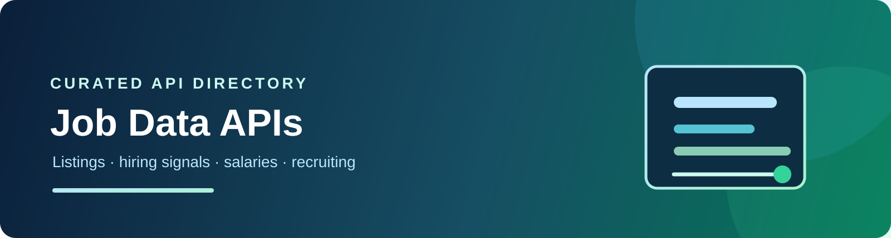

<div align="center">



<br />

# 💼 Job Data APIs and Scrapers

**Job listings, hiring signals, salary data, employer research, and recruiting APIs.**

[](https://github.com/cporter202/job-data-apis-and-scrapers/stargazers)
[](https://github.com/cporter202/job-data-apis-and-scrapers/actions/workflows/daily-sync.yml)
[](LICENSE)

<p>
  <a href="catalog/README.md"><strong>Browse API Lists</strong></a> ·
  <a href="#start-with-a-job-to-be-done"><strong>Start Building</strong></a>
</p>

</div>

## What this repo is

A focused directory for collecting job listings, company hiring signals, salary information, skills, employer profiles, and recruiting research data.

The API lists are the main content of this repository:

- [Browse Apify job APIs](catalog/README.md) — a large directory of ready-to-use actors.
- [Browse CoreClaw jobs APIs](catalog/coreclaw.md) — worker APIs with API and MCP access.

| API list | What you will find |
|---|---|
| [Apify API list](catalog/README.md) | The full jobs API directory, with one entry per actor and description. |
| [CoreClaw API list](catalog/coreclaw.md) | The full jobs API directory, with worker IDs and capabilities. |

| Coverage snapshot | Current directory |
|---|---:|
| Apify job actors | **1,149** |
| CoreClaw jobs workers | **12** |
| Sync cadence | **Daily** |

## Start with a job to be done

| If you need to… | Start here |
|---|---|
| Aggregate jobs across multiple boards | [Apify catalog](catalog/README.md) |
| Pull Glassdoor, Indeed, or LinkedIn data | [CoreClaw API list](catalog/coreclaw.md) |
| Normalize jobs and deduplicate listings | [Job aggregation playbook](playbooks/job-aggregation.md) |
| Turn hiring activity into a signal | [Hiring signals playbook](playbooks/hiring-signals.md) |
| Compare providers before building | [Provider selection checklist](playbooks/provider-selection.md) |

## Common build paths

- Multi-board job search and alerting
- Job deduplication and canonical schemas
- Skills, salary, and location analysis
- Employer and hiring-signal monitoring
- Recruiter and staffing dashboards
- Labor-market reports and datasets

## Provider notes

This repository preserves referral parameters present in the API lists where available. See [LINKS.md](LINKS.md) for a neutral referral-link note. A referral link is not an endorsement of fit, quality, legality, or pricing.

Respect job-board terms, robots rules, privacy obligations, employment-data regulations, rate limits, and restrictions on automated profiling. Do not use this directory as a substitute for legal or hiring advice.

## Maintenance

GitHub Actions checks the upstream Apify and CoreClaw category directories daily and updates only the catalog files when their content changes. Run the sync locally with:

```bash
node settings/sync_catalog.js
```

## Related directories

- [API Mega List](https://github.com/cporter202/API-mega-list)
- [Real Estate Data APIs](https://github.com/cporter202/real-estate-data-apis)
- [Ecommerce Intelligence APIs](https://github.com/cporter202/ecommerce-intelligence-apis)
